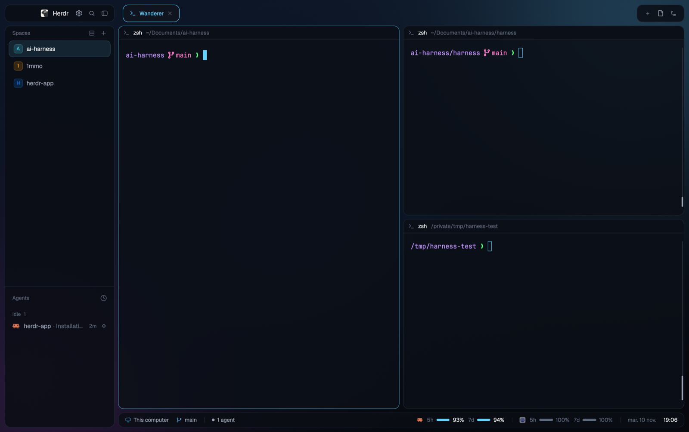

# Neon Islands — a Herdr layout

Rounded, translucent "islands" floating over a neon wallpaper: spaces and
agents on the left, tabs as pills, terminals as glassy cards, and a status
bar with agent counts, Claude/Codex quotas and a clock.



## Install

Ask your agent in Herdr:

> Add the layout github.com/alingavriliuc/herdr-neon-islands

Or by hand, copying into `~/.config/herdr-app` (rename anything whose name
is already taken):

```sh
git clone https://github.com/alingavriliuc/herdr-neon-islands
cd herdr-neon-islands
cp layouts/neon-islands.* ~/.config/herdr-app/layouts/
cp themes/neon-islands.json ~/.config/herdr-app/themes/
mkdir -p ~/.config/herdr-app/backgrounds && cp backgrounds/neon-islands.png ~/.config/herdr-app/backgrounds/
cp -R mods/islands-* ~/.config/herdr-app/mods/
herdr-app do layout.switch '{"name":"neon-islands"}'
```

`ctrl-shift-l` switches back to your previous layout.

## What it touches

- Runs `git` and `hc` to show branches and machines in the spaces list.
- Reads `~/.cache/herdr/claude-quota.json` and `~/.codex/sessions` for the
  quota meters (optional; see `RECIPE.md`).
- No network access.

## Tweak

`mods/islands-workspace-chrome/settings.json`:

```json
{ "opacity": 0.85, "main_opacity": 0.85 }
```

`opacity` is the islands' fill, `main_opacity` the terminal cards'.

See [RECIPE.md](RECIPE.md) for the full brief.
