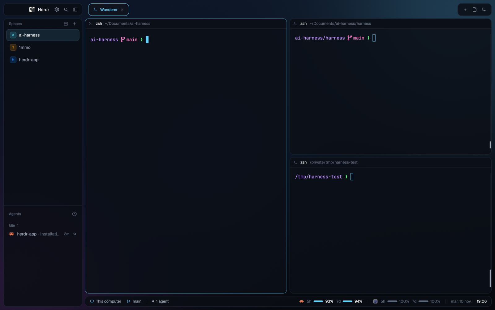

# Neon Islands

A dark, glassy Herdr window where every region is its own rounded "island"
floating over a deep blue-violet neon wallpaper: a brand bar and a
spaces/agents card on the left, a tab strip, the terminals as translucent
cards with a header each, and a status bar with agent counts, Claude/Codex
quota meters and a clock. The terminals are transparent, so the wallpaper
glows through behind the text. Cyan (`#64d2ff`) is the only accent.

## What you see

Left to right, with 10px of wallpaper around the window and 8px between
every island; every island has a 12px radius and a 1px `border`
(`#1e2735`) and is filled with its theme color at 85% opacity.

- **Background:** `backgrounds/neon-islands.png` (1600×1000, `cover`) behind
  the whole window. No system title bar; macOS traffic lights sit at
  `[24, 28]`, inside the brand island.
- **Sidebar column (226px, min 44, max 480, not drag-resizable):**
  - **Brand island (38px tall)**, `chrome` fill: the Herdr logo
    (`frame/welcome/herdr.png`, 20px, 5px radius) and **Herdr** in
    semibold 13.5px, then three 26px icon buttons: Settings (with a 6px
    accent dot when an app update is ready), Search (opens the `picker`),
    sidebar toggle. On macOS it leaves 76px on the left for the traffic
    lights. The island drags the window.
  - **Lists island** (rest of the height): Spaces (weight 1.3, min 90) above
    Agents (weight 0.7, min 90), split by a 1px `border` divider.
    - Spaces: a "Spaces" header with a by-machine toggle and +; each space a
      row with a colored letter avatar and its name; the selected one sits
      on a `selected` card. Worktree spaces nest under their repo with a
      branch glyph; ahead/behind (`↑2 ↓1`) on the right when unusual. Spaces
      group under a header per machine once another machine is known.
    - Agents: an "Agents" header with a sort button (clock icon; grouped or
      priority views, chosen in a popup), sections like `Idle 1`, each agent
      a row: program icon, `space · detail`, age (`2m`), status mark.
- **Work column (rest of the width):**
  - **Tab strip (38px)**: each tab a pill with a `>_` icon and its name;
    the active one has a cyan outline and an ×. A separate card on the right
    holds `+` (opens `new-menu`), Files and Changes panel buttons, and on
    Windows/Linux minimize/maximize/close. Drags the window.
  - **Terminals**: the active tab, each pane a card (12px radius, 8px gap,
    framed even when alone) on `#0b0f17` at 85%; the focused one gets a
    1px `#64d2ffb3` border. Terminal padding `[16, 14]`, terminal opacity 0.
    A 30px header on top: program icon, name (medium 12px), folder in `dim`
    with `~` for home, then the agent's status; on hover split right, split
    down, zoom, close.
  - **Side panel (368px, min 280, max 900, hidden at first)**: a stack of
    the shipped `files` and `changes` mods, beside the terminals.
  - **Status bar (32px)**: left, `This computer` (or the machine) with a
    `working`-colored monitor icon, the branch in accent, `• 1 agent`, and
    `N running` / `N done` / a red `N needs you` pill; right, Claude's then
    Codex's quotas (`5h ▬▬ 93%  7d ▬▬ 94%`), the date (`mar. 10 nov.`, in
    French) in `dim` and the time `19:06` in `foreground`.
- **Theme** `neon-islands`: background `#0b0f17`, foreground `#e8eef5`,
  chrome `#0a0d14`, surface `#0f141e`, raised `#18202d`, selected
  `#16283a`, border `#1e2735`, muted `#98a2b3`, dim `#5c677a`, accent and
  working `#64d2ff`, blocked `#ff453a`, done `#30d158`. Fonts: Herdr's
  defaults (JetBrains Mono, Geist) unless settings say otherwise.

## How it behaves

- **working**: a cyan ring spinner (`spin(900)`) in the pane header, the
  tab pill and the agent row; `N running` in cyan in the status bar.
- **blocked**: a red `Needs you` chip in the pane header, a red mark in the
  agents list, and a red `N needs you` pill whose dot pulses
  (`loop("opacity", 0.35→1, 900ms)`) in the status bar.
- **done**: a 7px green dot in the pane header and the list; `N done` in
  green. Looking at it turns it idle; it stays in the Done section until you
  leave it.
- **idle**: a hollow ring in `dim`.
- Spaces: click selects, right-click opens the shipped `menu`, drag
  reorders (within its machine). Tabs: click selects, double-click renames,
  drag reorders, right-click opens the tab menu, × closes; when they don't
  fit, the others shrink to icons. Agents: click focuses the pane, the pin
  pins it to the top (`terminal.pin`), sub-agents open with `terminal.peek`.
- Sidebar toggle (or the agents list's ») folds the sidebar to a 44px rail
  (76px on macOS) of avatars and agent tiles, and back to its width.
- The Files/Changes buttons open the side panel; which one was open is
  remembered per space.
- Translucency: `mods/islands-workspace-chrome/settings.json`
  `{ "opacity": 0.85, "main_opacity": 0.85 }`; editing it applies live to
  every island and to the panes (written into the layout with
  `layout.set`).

## Built from

- `layouts/neon-islands.json`: root `row` (padding 10, gap 8, background
  image, `theme: "neon-islands"`, `titlebar: "none"`, `traffic_lights`,
  `terminal_opacity: 0`, `terminal_padding: [16, 14]`, `preview`):
  - `sidebar` column: `brand` block (`islands-workspace-chrome`,
    `window_drag`) and `sidebar-lists` column (`spaces` →
    `islands-spaces`, `agents` → `islands-agents`).
  - `work` column: `tabs` block (`islands-tabs`, `window_drag`),
    `work-body` row (`main` = `{ "tab": "active" }` with the pane frame and
    `islands-pane` header; `panel` column → `panel-body` stack of `files`
    and `changes`), `status` block (`islands-workspace-status`).
- `themes/neon-islands.json` (named like the layout, so it's this layout's
  own), `backgrounds/neon-islands.png`, `layouts/neon-islands.svg`.
- Mods: `islands-workspace-chrome` (brand bar; reads its `settings.json`
  with `readTextFile` + `watchFolder` and shares `islands.opacity` /
  `islands.mainOpacity`), `islands-spaces` (`spaces`, `machines`, `panes`,
  `hc machine ls`, `git status` via `exec`, `watchFolder`, shared
  `space.colors`), `islands-agents` (`agents`, `terminals`,
  `setAgentOrder`, `terminal.pin`, `terminal.peek`, shared `agents.sort`),
  `islands-tabs` (`tab.*`, `layout.select/show/hide` for the panel, shared
  `workspace.panels`), `islands-pane` (pane header), and
  `islands-workspace-status` (status bar).
- Shipped mods and assets it uses: `files`, `changes`, `menu`, `new-menu`,
  `picker`, `machine-add`, icons from `mods/workspace-chrome/` and
  `mods/pane/`, `frame/welcome/herdr.png`.
- Programs: `git` and `hc` (spaces list), `sh` + `find`/`grep` (Codex
  quotas). Nothing reaches the network.

## Watch out

- Claude quotas come from `~/.cache/herdr/claude-quota.json`
  (`{ rate_limits, updated }`), which this layout doesn't write: a Claude
  Code status line script must write it from its input's `rate_limits`.
  Codex quotas are read from the latest `~/.codex/sessions/**/rollout-*.jsonl`
  of the last 8 days. Without them the meters are simply absent; older than
  6 h, they show dimmed.
- The date in the status bar is in French (day and month names in the mod).
- The main pane's background is rewritten by `islands-workspace-chrome`
  from `main_opacity` and the theme's `background`; a hand edit of
  `main.content.pane.background` is overwritten.
- Mods can't measure text: tab widths are estimated (~6.2px a character at
  12px).
- The islands' translucency only works on `#rrggbb` theme colors.
- Every mod's `mod.json` is `"place": "none"`: they appear only where the
  layout puts them.

## Done when

- `herdr-app check` passes for each of the six `islands-*` mods.
- `herdr-app do layout.switch '{"name":"neon-islands"}'` shows the wallpaper
  around rounded, translucent islands, with no `layout.error`.
- Starting an agent shows the spinner in its pane header, tab and agents
  row, and `1 running` in the status bar; a blocked agent shows `Needs you`
  and the pulsing red pill.
- The sidebar toggle folds the sidebar to a rail and back.
- The Files and Changes buttons open the side panel, remembered per space.
- Setting `"opacity": 1` in `mods/islands-workspace-chrome/settings.json`
  makes the islands opaque at once.
